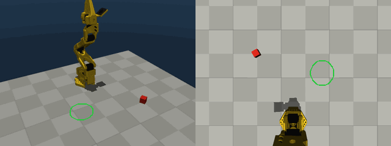

# so101_mtc

Pick and place of a block with the simulated SO-101 arm by classical planning: a fixed camera finds the block with
OpenCV, MoveIt 2 and MoveIt Task Constructor (MTC) plan the grasp and the place, ros2_control executes them.

It is the second project of a series that solves the same task with different methods and compares them on the same
metrics (success rate over 50 episodes, time per pick and place): imitation learning (webcam teleoperation and ACT,
`so101_lerobot`), classical planning (this repository) and reinforcement learning (planned).



- **Result:** with the block's pose from the camera, 49 of 50 episodes pass project 1's success check (98 %, 95 %
  interval 89.5–99.6 %), the same 49 in two runs; the block is released 10.1 s after the task's call (median).
- **Project 1, the same task:** its ACT policy succeeds in 33 % of 50 episodes, its teleoperated demonstrations in
  89 %, in 27.8 s and 17.8 s (median); see [Comparison with project 1](#comparison-with-project-1).

## Status

M1–M4 done: one command starts MuJoCo with the robot, the table, the block and the camera, the controllers, MoveIt
with MTC's capability and RViz ([Run the simulation](#run-the-simulation)); the MTC task picks the block and places
it on a target ([Pick and place with MTC](#pick-and-place-with-mtc)), 20 of 20 trials from the block's true pose
([Trials](#trials)); the block's pose comes from the fixed camera
([Block pose from the camera](#block-pose-from-the-camera)); 50 episodes with the camera
([Evaluation: 50 episodes](#evaluation-50-episodes)). M5, the release, adds the [Docker](#docker) image, `colcon
test` in CI and the [comparison with project 1](#comparison-with-project-1).
The scope and the exit criteria are fixed in [ADR 0001](docs/decisions/0001-project_scope_and_exit_criteria.md),
the nodes, topics and TF frames in [docs/architecture.md](docs/architecture.md). The stack is fixed in
[ADR 0002](docs/decisions/0002-simulator_mtc_build_and_robot_model.md): MuJoCo through `mujoco_ros2_control`, MTC
from apt on `/opt/ros/jazzy`, the official SO-101 model. The grasp poses and the IK for the arm's 5 joints are fixed
in [ADR 0003](docs/decisions/0003-ik_and_grasp_poses.md): top-down near the base, tilted further out, exactly
reachable poses for MoveIt's default KDL. The ADRs cite their sources; paths under `~/code/` and `~/data/` there are
the author's local experiments and data, outside this repository.

## Packages

- `so101_mtc_perception/` — block detection and camera geometry; plain Python without ROS, tested in CI.
  `so101_mtc_perception_ros/` — the node `block_detector`: the camera's image → `/block_pose`
  ([Block pose from the camera](#block-pose-from-the-camera)).
- `so101_mtc_description/` — the official SO-101 with `world`, the table, the TCP and the fixed camera (URDF), the
  MuJoCo scene with the block, and the task's parameters; see
  [Robot description and scene](#robot-description-and-scene).
- `so101_mtc_moveit_config/` — our MoveIt 2 config: the SRDF with the end effector at the TCP, KDL, joint limits,
  OMPL, the ros2_control and MoveIt controllers, and `move_group` with MTC's capability; see
  [MoveIt config](#moveit-config).
- `so101_mtc_bringup/` — one launch for everything: MuJoCo, the controllers in order, MoveIt and RViz.
- `so101_mtc_task/` — the pick and place task in C++: the generator of grasp and place poses that the 5-joint arm
  reaches exactly ([Grasp and place poses](#grasp-and-place-poses)) and the MTC node that picks the block and places
  it on a target ([Pick and place with MTC](#pick-and-place-with-mtc)).
- `so101_mtc_interfaces/` — the service `PickPlace`: one pick and place on request.
- `so101_mtc_eval/` — the trials without ROS: the draw of the block and the target, project 1's success check, the
  records with their summary and the camera's errors; plain Python, tested in CI. `so101_mtc_eval_ros/` — the trial
  runner ([Trials](#trials)) and the camera's measurement (`measure_perception`); it installs `so101_mtc_eval`.

## Workspace setup

Ubuntu 24.04 with ROS 2 Jazzy from apt ([installation](https://docs.ros.org/en/jazzy/Installation/Ubuntu-Install-Debs.html),
then `sudo rosdep init` and `rosdep update` once); the workspace builds on `/opt/ros/jazzy` only (no MoveIt from
source):

```bash
mkdir -p so101_mtc_ws/src && cd so101_mtc_ws/src
git clone https://github.com/PiotrKonopkaRobotyka/so101_mtc.git
cd .. && python3 src/so101_mtc/tools/fetch_models.py   # pinned SO-101 models into src/ (~55 MB on disk)
sudo apt install ros-jazzy-moveit ros-jazzy-moveit-task-constructor-core \
  ros-jazzy-moveit-task-constructor-capabilities ros-jazzy-moveit-task-constructor-visualization \
  ros-jazzy-mujoco-ros2-control
rosdep install --from-paths src/so101_mtc --ignore-src -y   # what the packages of this repository declare
colcon build --symlink-install
source install/setup.bash
```

The build needs the fetched models: `so101_mtc_description` installs them from `src/SO-ARM100` and
`src/mujoco_menagerie` and stops with a message when they are missing. The results here were measured with
CycloneDDS as the ROS middleware (`sudo apt install ros-jazzy-rmw-cyclonedds-cpp`, then
`export RMW_IMPLEMENTATION=rmw_cyclonedds_cpp`, e.g. in `~/.bashrc`); the Docker image sets it.

Upgrade ROS packages a whole sync at a time (`sudo apt upgrade`): their dependencies carry no versions, so a partial
upgrade can mix incompatible binaries. `rosdep` installs what the packages declare (MoveIt, MTC with its capability
and panel, the MuJoCo bridge, the controllers); the apt line installs the largest of them in one go.

### Docker

The [Dockerfile](Dockerfile) builds the same workspace on `osrf/ros:jazzy-desktop`: the apt dependencies through
`rosdep`, the models, `colcon build`, with CycloneDDS as the ROS middleware. From the repository's root:

```bash
docker build -t so101_mtc .   # downloads about 1.7 GB; CI builds it in 5 minutes
xhost +local:docker           # lets the container open windows on your display
docker run -it --rm --net=host -e DISPLAY -v /tmp/.X11-unix:/tmp/.X11-unix so101_mtc   # the simulation and RViz
```

Append a command to run something else in the container, e.g. `bash` for a shell with the workspace sourced. CI
checks the image's build, its tests and a run of the whole system without windows ([Tests](#tests)); the last command,
the usual X11 setup for the windows, has not been run yet.

## Run the simulation

```bash
ros2 launch so101_mtc_bringup sim.launch.py   # [headless:=true] [rviz:=false] [sim_speed_factor:=5.0]
```

The MuJoCo window shows the scene; RViz shows the robot, the MotionPlanning panel (drag the marker at the TCP, then
Plan & Execute), the MTC panel and the fixed camera's image. The launch starts things in order, by events rather
than sleeps: `robot_state_publisher` and MuJoCo's `ros2_control_node`, then `joint_state_broadcaster`, then the arm's
and the gripper's controllers, then `move_group` and RViz. A controller that fails to start stops the launch, and so
does closing the MuJoCo window.

- `headless:=true` runs MuJoCo without its window; `rviz:=false` leaves RViz out.
- `sim_speed_factor` sets the simulation's speed against real time (5.0: five times faster); below 0, real time.
- The block's true pose is on `/block/free_joint_states`; `/mujoco_ros2_control_node/set_free_joint_state` moves it,
  `/mujoco_ros2_control_node/reset_world` resets the scene (with the arm's controllers deactivated first).
- The camera publishes `/camera/image_raw`, `/camera/depth/image_raw` and `/camera/camera_info` in
  `camera_optical_frame` at 10 Hz of simulation time; Menagerie's wrist camera publishes under
  `/mujoco_camera_plugin/wrist_cam/`, the scene's overview camera (front right, for videos) under
  `/mujoco_camera_plugin/overview/`.

## Robot description and scene

`so101_mtc_description` holds what ROS and MuJoCo need to know about the robot and its surroundings:

- `urdf/so101_mtc.urdf.xacro` — the official URDF `so101_new_calib`, included unmodified, plus our frames: `world`,
  the table, `tcp` (the centre of a grasped 25 mm block, ADR 0003; z out of the jaws, like the upstream
  `gripper_frame_link`), `camera_link` and `camera_optical_frame` (REP 103), and the `ros2_control` tag for
  `mujoco_ros2_control`, with the joints starting at the home pose.
- `mujoco/scene.xml.xacro` — the MuJoCo scene: the Menagerie SO-101 attached unmodified, the table, the block
  (a free body) and the fixed camera. MJCF has no variables, so the build expands this template with the block of
  `config/task.yaml` and installs the result as `mujoco/scene.xml`.
- `config/task.yaml` — the task shared with project 1 (its ADR 0009): the 25 mm, 10 g block, the area the block and
  the target are drawn from (a ring sector around the shoulder_pan axis, 0.12–0.34 m, ±60°) and the target disc
  (5 cm radius).
- `upstream/` (only in the installed package) — the fetched models, so that every file is found by package name:
  the URDF's meshes as `package://so101_mtc_description/upstream/SO101/assets/…` (the build writes a copy of the URDF
  with these paths; the fetched files stay untouched) and the Menagerie model next to the scene.

Show the robot in RViz, with sliders for its joints (no simulator):

```bash
ros2 launch so101_mtc_description display.launch.py
```

Build again after editing `scene.xml.xacro` or `task.yaml`; the other files are linked into `install/` by
`--symlink-install` and take effect at once. MuJoCo loads the installed scene,
`$(ros2 pkg prefix --share so101_mtc_description)/mujoco/scene.xml`.

## MoveIt config

`so101_mtc_moveit_config` is our own MoveIt 2 config for the official SO-101, written by hand (not with the MoveIt
Setup Assistant):

- `config/so101_mtc.srdf` — the groups `arm` (the chain `base_link` → `tcp`) and `gripper` (the moving jaw), the end
  effector at `tcp`, the named states `home` (the start pose), `open` (1.2 rad) and `closed` (0.0 rad, past the
  block), and the link pairs MoveIt does not check (see [Collision pairs](#collision-pairs)).
- `config/kinematics.yaml` — KDL on the full pose (ADR 0003). `config/joint_limits.yaml` — velocity and acceleration
  limits (the URDF's are placeholders). The planner is OMPL with MoveIt's default settings.
- `config/ros2_controllers.yaml` — the ros2_control controllers: `joint_state_broadcaster`, `arm_controller` (joint
  trajectories) and `gripper_controller`, a parallel gripper action controller. It closes toward `closed` and reports
  success once the jaw stops on the block (`allow_stalling`, ADR 0002); the servo limits the force (2.94 N·m in
  MuJoCo), and on the 25 mm block the jaw rests at 0.065 rad. The arm's controller accepts a trajectory that ends at
  a tiny velocity, as MTC's time parameterisation leaves it (about 1e-3 rad/s); MoveIt's reference configs do the same.
- `config/moveit_controllers.yaml` — MoveIt → those controllers (`FollowJointTrajectory`, `ParallelGripperCommand`),
  with a start tolerance of 0.2 rad for the gripper: a planned opening starts from `closed` while the jaw rests on
  the block. MoveIt allows 3 s past a trajectory's planned end: the gripper's goal ends only once the jaw stops on the
  block, later when the block turns between the closing jaws.
- `.setup_assistant` — tells `MoveItConfigsBuilder` where the URDF (`so101_mtc_description`) and the SRDF are, so that
  every launch file builds the same config:
  `MoveItConfigsBuilder("so101_mtc", package_name="so101_mtc_moveit_config")`.
- `launch/move_group.launch.py` — `move_group` with MTC's `ExecuteTaskSolutionCapability`;
  `launch/moveit_rviz.launch.py` — RViz with the MotionPlanning display, the MTC panel and the camera image.

The controllers YAML lives here, next to `moveit_controllers.yaml`, because the two must name the same controllers
and joints (the test checks it); the bringup starts the simulator with it. `move_group` executes only with the
controllers running, so it is started by the bringup (M1):

```bash
ros2 launch so101_mtc_moveit_config move_group.launch.py
ros2 launch so101_mtc_moveit_config moveit_rviz.launch.py
```

### Collision pairs

MoveIt's `collisions_updater` (the Setup Assistant's collision sampling, from the command line) finds the link pairs
MoveIt need not check, over 10000 random states. It rewrites the whole SRDF without its comments, so copy only its
`disable_collisions` lines into `config/so101_mtc.srdf`:

```bash
xacro $(ros2 pkg prefix --share so101_mtc_description)/urdf/so101_mtc.urdf.xacro > /tmp/so101_mtc.urdf
ros2 run moveit_setup_assistant collisions_updater --urdf /tmp/so101_mtc.urdf \
  --srdf src/so101_mtc/so101_mtc_moveit_config/config/so101_mtc.srdf --output /tmp/so101_mtc.srdf \
  --default --always --trials 10000
```

It found 7 adjacent pairs and 6 pairs that never collided; none collides always or at the zero pose. A sample proves
nothing, so the 6 "Never" pairs were checked on a dense grid of the joints between the two links (MoveIt's distance,
through `moveit_py`): the closest stays 8.9 mm apart within the joint limits. `--trials 0` does not skip the sampling;
it marks pairs "Never" without testing them, some of which do collide.

## Grasp and place poses

The SO-101 has 5 arm joints. Its three pitch joints keep the `wrist_roll` axis in one vertical plane, which
`shoulder_pan` turns, so the arm reaches a gripper pose only when the roll axis lies in that plane. Grasp poses
sampled around the block (MTC's `GenerateGraspPose`) mostly miss it and have no IK solution. `so101_mtc_task`'s
library `grasp_poses` builds the poses the arm reaches exactly ([ADR 0003](docs/decisions/0003-ik_and_grasp_poses.md)),
which the MTC task takes through `GeneratePose` and `ComputeIK` with KDL:

- **Plane azimuth in closed form:** the plane must hold the roll axis, which lies 3.9 mm from the `tcp`, and the
  plane itself lies e = 0.18 mm from the `shoulder_pan` axis. For a point p of `gripper_link` that has to land on c,
  the azimuth θ of the plane follows from `r sin(φ − θ) = p_x cos β − p_y sin β + e`, where (r, φ) is c about the pan
  axis and β the jaw angle.
- **Families by the distance from the `shoulder_pan` axis:** top-down up to 0.23 m, with the jaws facing the block's
  sides (four directions); tilted 15° up to 0.29 m and 30° beyond, leaning away from the base, with the jaws
  horizontal (two sides).
- **Waypoints:** a grasp has a pre-grasp 5 cm back along the approach and a lift 5 cm up. A place has a pre-place 5 cm
  up and a retreat 5 cm back along the approach.
- **Jaw sides:** `wrist_roll` = β + 92.8° and stops at −157°/+163°, so a jaw direction in that gap uses the other
  jaw side; the generator leaves such sides out.
- **Approach gap:** the `tcp` is the centre of a block pressed onto the fixed jaw, so the descent stops with the `tcp`
  3.6 mm towards the fixed jaw; otherwise the fixed jaw drags the block. When the block's sides do not face the jaws
  (tilted grasps), its corner reaches further across them, so the gap grows by half the edge × (cos ψ + sin ψ − 1)
  for the misalignment ψ, up to 5.2 mm at 45°. Closing then turns the block and pushes it onto the fixed jaw.
- **Place height:** the held block keeps its pose in the gripper since the grasp, and it tilts when the place uses
  another family than the grasp. The place puts the block's centre over the target and its lowest corner 3 mm above
  the table.

The kinematic facts come from the robot model at zero joint values: the pan axis, the plane's offset, `wrist_roll`'s
zero and limits, the `tcp` and the fixed jaw's side. The generator throws when the model breaks its assumptions, for
example non-parallel pitch axes. Everything else is in `config/grasp_poses.yaml`, its only source: the families, the
distances, the gap and the clearance. The MTC node loads the same file.

The test checks the poses against MoveIt itself, without a simulator. It loads our URDF and SRDF with KDL as
`move_group` does, and asks for a collision-free solution (robot and table, gripper open) of every pose over the task
area: the block every 5 mm and 5°, the target every 1 cm and 10°.

- **Grasps:** 9405 IK solves (grasp, pre-grasp, lift), none failed. MoveIt's FK returns each pose within 0.01 mm and
  0.0004°, and the predicted `wrist_roll` is the solution's.
- **Places:** 5382 solves for blocks held after a top-down, a 15° and a 30° grasp, none failed.
- **The gap:** all 265 jaw sides left out for `wrist_roll` have no solution.
- **Family limits:** run with the limits of ADR 0003's map (0.24 m and 0.30 m), the same test failed only there: the
  pre-grasp or the pre-place, 5 cm above, is out of reach. Hence 0.23 m and 0.29 m (ADR 0003's update).

## Pick and place with MTC

`so101_mtc_task`'s node `pick_place` plans the pick and place with MoveIt Task Constructor and lets `move_group`
execute it. With the simulation running ([Run the simulation](#run-the-simulation)):

```bash
ros2 launch so101_mtc_task pick_place.launch.py   # [execute:=false] [run_at_start:=false]
ros2 service call /pick_place/pick_place so101_mtc_interfaces/srv/PickPlace "{target: {x: 0.20, y: -0.10}}"
```

The launch file loads the robot as `move_group` does, with `config/grasp_poses.yaml` and `config/pick_place.yaml`
(the target of the run at start-up, the distances, the scaling and the timeouts). At start-up the node picks the block
and places it on that target; each call of `~/pick_place` does it again, for the block where it lies and the target
of the request (a point on the table top). The response and the log give the result: whether planning and execution
succeeded, the failing stages, the planning and execution times, and the grasp and the place that ran. RViz's MTC
panel ("Motion Planning Tasks") shows the stages and the solutions.

- **Stages** (after `mycobot_mtc_pick_place_demo`): current state → allow block–table → open → move to pick (OMPL) →
  pick: approach 5 cm along the tcp's z, the grasp poses with IK, allow hand–block, close, attach the block in the
  hand, lift 5 cm, forbid block–table → move to place (OMPL) → place: lower 5 cm, the place poses with IK, release,
  detach, retreat 5 cm, forbid hand–block → home.
- **Poses:** the grasps come from `grasp_poses` for the block's true pose (`/block/free_joint_states`), one candidate
  per family and jaw side; the places are computed while planning, from the block's pose in the hand. MTC runs the
  cheapest solution.
- **The block in the hand:** closing pushes the block onto the fixed jaw and turns its sides to the jaws, so it ends
  centred on the tcp. The planning scene attaches it there rather than where it stood, so the place fits the block
  that is really held.
- **Free motions move the arm only:** `move_group` executes each part of a solution through the SRDF group that moves
  exactly its joints, and the gripper keeps its state between the grasp and the place.

In MuJoCo, six pick and places with blocks of every family ended with the block on the target, 3–9 mm from its centre
and flat on the table. They included two in each family, and two tilted grasps of blocks turned 35–40° against the
jaws. Planning took 0.7–2.0 s, execution about 12.5 s.

## Trials

The trials judge the pick and place in the simulator, by project 1's success check, as fixed in
[ADR 0004](docs/decisions/0004-evaluation_protocol.md) before the first one:

- **Draw:** the block and the target come from the task area as project 1's simulator draws them, with a seed.
- **Success:** for the last 0.2 s of a second after the task, the block lies on the target disc (5 cm), rests on the
  table on a face, is still, and the hand is away from it. Project 1 also checks the contact forces, which ROS does
  not show.
- **Each trial:** the gripper opens and the arm goes home, the block is put down, `/pick_place/pick_place` runs, the
  block's pose decides. No retries; one CSV row per trial, a JSON summary per run, under
  `$DATA_DIR/so101_mtc/m2/`.

With the simulation and the task node running (`pick_place.launch.py run_at_start:=false`):

```bash
ros2 run so101_mtc_eval_ros run_trials --trials 20 --seed 0   # about 18 s per trial; --dry-run lists the draw
```

**M2 result** (20 trials, seed 0): **20 of 20 succeeded**, 95 % Wilson interval 84–100 %. By grasp family: top-down
12 of 12, tilted 15° 6 of 6, tilted 30° 2 of 2. Among the tilted grasps, three blocks were turned 27–38° against the
jaws (ADR 0003's open point); all three ended on the target. The block ended 5.1 mm from the target's centre
(median; at most 12.3 mm). Planning took 1.5 s (median; at most 1.9 s), a whole pick and place 14.2 s (median; from
the call to the arm back home).

## Block pose from the camera

With `camera:=true`, the task takes the block's pose from the fixed camera instead of the simulator
([ADR 0005](docs/decisions/0005-block_detection_from_the_fixed_camera.md)):

```bash
ros2 launch so101_mtc_task pick_place.launch.py camera:=true   # also starts block_detector
```

- **Detection** (`so101_mtc_perception.detect`, OpenCV 4.6 from apt): the block is red on a grey table. A hue,
  saturation and brightness threshold keeps its lit top face, without the darker sides that the camera sees at an
  angle. `minAreaRect` fits the face's square.
- **Pose:** the face's centre and two corners go through `pixel_to_plane` onto the plane of the top face, 25 mm
  above the table. That gives the block's position and its yaw modulo 90°; the camera's pose comes from TF and its K
  from `camera_info`.
- **The node** (`block_detector`) publishes `/block_pose` with the image's stamp. The task uses a pose only if it is
  at most 1 s old, so a pose from before a reset of the block never counts.

The error over the block area (`ros2 run so101_mtc_eval_ros measure_perception --seed 1`, the 50 blocks of
ADR 0004's draw with seed 1, the arm at home): **all 50 found; position error 0.91 mm median, 1.15 mm at the 95th
percentile, 1.19 mm at most; yaw error 0.25° median, 1.4° at the 95th percentile, 2.6° at most.** A pixel covers
about 1.2 mm of the table.

## Evaluation: 50 episodes

M4 runs the [trials](#trials) with the block's pose from the camera: the 50 episodes of ADR 0004's draw with seed 1,
each from the arm at home to the success check, without retries. With the simulation running:

```bash
ros2 launch so101_mtc_task pick_place.launch.py run_at_start:=false camera:=true
ros2 run so101_mtc_eval_ros run_trials --trials 50 --seed 1 --out m4   # about 15 minutes
```

**Result** (two runs of the same 50 episodes, 2026-11-19 and 2026-11-20):

- **Success: 49 of 50 in each run (98 %, 95 % Wilson interval 89.5–99.6 %).** Both runs chose the same grasp and the
  same place in every episode and failed the same one. The block ended in the same place to within 1 mm in 47
  episodes (to 0.01 mm in 39); the other three ended 2.0, 6.4 and 17.1 mm apart.
- **By grasp:** top-down 24 of 25, tilted 15° 12 of 12, tilted 30° 13 of 13. **Failures by stage:** perception 0,
  planning 0, execution 0, grasp 0, place 1.
- **Time per pick and place** (ADR 0001's metric as ADR 0004 times it: from the task's call to the release; the
  second run's 49 successes): 10.1 s mean and median, SD 0.8 s, 7.8–12.1 s. Planning takes 1.0 s of it (median; at most 1.9 s), and the arm moves at half
  its joints' speed limits. The whole task, until the arm is back home, takes 14.0 s (median).
- **Accuracy:** the block ends 4.3 mm from the target's centre (median of the successes; at most 18 mm).

**Where the block lands, and the failure.** The generator takes each family from its own point's distance: the
grasp's from the block's, the place's from the target's. When they differ, the hand turns between the grasp and the
place, the block held square to the jaws reaches the table tilted by as much, and when released it tips onto a face.
The more the hand turns, the further from the target's centre the block lands (median of all episodes, the failure
included, the same in both runs): 3.2 mm when the hand keeps its tilt (20 episodes), 4.4 mm after a turn of 15° (23),
9.4 mm after 30° (7). Episode 35 fails in both runs, and again in a replay that traced the block in the hand: a
top-down grasp 0.19 m from the shoulder_pan axis, then a place tilted 30° for a target 0.32 m out, 118° around the
axis (the longest swing of the 50; median 33°). While the arm swings and the hand turns, the block slides about
15 mm sideways along the jaws' faces until the jaws close on nothing; it falls 5 cm onto the table well before the
release and lands 75 mm from the target's centre. Episode 36 makes the same turn in a swing of 19°: the block stays
in the hand, reaches the table tilted 29° and tips when released, 11 mm from the centre. A fix to try (M4's protocol was fixed before its results, so it stays untried here): choose the
grasp's family for the target as well, so that the hand keeps its tilt from the grasp to the place.

The rows behind these numbers are in [docs/results/](docs/results/): M2's trials (`m2_trials_seed0.csv`), M3's
camera errors (`m3_perception_seed1`), M4's two runs (`m4_trials_seed1_run1`, `_run2`; CSV rows and JSON summaries)
and the traces of episodes 35 and 36 (`m4_episode35_trace.csv`, `m4_episode36_trace.csv`): at 50 Hz from the call,
the block's pose, its tilt from flat, its lowest corner above the table, its distance from the target, the gripper's
joint, the tcp, and the block's centre in the tcp's frame (mm).

## Comparison with project 1

[so101_lerobot](https://github.com/PiotrKonopkaRobotyka/so101_lerobot) solves the same task by imitation: 50
demonstrations by webcam teleoperation, then LeRobot's ACT policy. Its numbers are from its README (2026-11-16):

| Method, 50 episodes | Success | Time per pick and place |
| --- | --- | --- |
| MTC and the camera (this repository) | 49 and 49 of 50 (98 %; 95 %: 89.5–99.6 %) | 10.1 s mean, 10.1 s median |
| Project 1: ACT, 50,000 steps | 17 and 16 of 50 (33 %; 95 %: ±13 points) | 31.8 s mean, 27.8 s median |
| Project 1: teleoperation, the demonstrations | 50 of 56 (89 %) | 20.0 s mean, 17.8 s median |

- **The same:** the 25 mm block, the area it starts in, the target disc of 5 cm radius and the draw of both, the
  success conditions, 50 episodes from the arm at home, MuJoCo with SO-101.
- **Not the same:** the scenes are other samples of the same draw (seeds 1000–1049 of so101-nexus there, seed 1 of
  ADR 0004 here). The success conditions are checked here from poses instead of contact forces (ADR 0004): that the
  table carries the block and that nothing pushes on it are read from its height and the hand's distance. The clock
  runs from the task's call to the release here, and from the episode's start to the success there, which also waits
  for the block to rest 0.2 s: a few tenths of a second later for the same motion.
- **What each method is given:** MTC gets the robot's model, the block's size and colour, the camera's calibration and
  hand-made grasp families for 5 joints (ADR 0003), and no data. ACT gets 17.5 minutes of demonstrations and 3.5 h of
  training on a GPU, and sees only its two cameras and the joints; it knows nothing of the block or the kinematics.
- **What the numbers say:** with everything known, planning wins by far: three times the success in a third of the
  time, at half the joints' speed. Its failure is systematic: the same episode in both runs, from a cause that the
  trace shows and a change of rules may remove. ACT's are not: only 8 scenes succeeded in both of its runs, and most failures were
  missed grasps.
- **What planning pays for it:** every assumption is code. Another object, colour, light or clutter needs a new
  detector or new grasp rules, where ACT needs new demonstrations; a real arm would also need the camera and the arm
  calibrated, which the simulator gives for free.

## Tests

The ROS-free cores need only numpy, OpenCV and pytest (on Ubuntu 24.04:
`sudo apt install python3-numpy python3-opencv python3-pytest`); each has its own `pyproject.toml`, so each runs on
its own:

```bash
python3 -m pytest so101_mtc_perception
python3 -m pytest so101_mtc_eval
```

GitHub Actions runs the same tests with Ubuntu 24.04's apt packages, the versions this project uses, on every push
to `main` and every pull request ([tests.yml](.github/workflows/tests.yml)). A second job builds the
[Docker](#docker) image and runs in it `colcon test` and [tools/smoke_test.sh](tools/smoke_test.sh), the whole system
without windows.

The ROS packages are tested from the workspace, after the build (ROS 2 Jazzy):

```bash
colcon test && colcon test-result --verbose   # about 35 s, 30 of them so101_mtc_task's IK sweep
src/so101_mtc/tools/smoke_test.sh             # about a minute; exit code 0 when both trials succeed
```

The smoke test starts the simulation without windows and the task node with the camera's detector, on its own ROS
domain, and runs the first two trials of M4's draw with the success check; its logs go to a temporary folder.

The test expands the xacro, lets MuJoCo's `compile` load the scene, and checks that the two agree: the joints and
their limits, the poses of all links over random joint angles, the camera and the table; that `tcp` is where ADR 0003
puts it; and that the table and the camera's view hold the whole task area. The MoveIt config's test loads the robot
into MoveIt through `moveit_py`, without a simulator: the groups and the end effector, the named states (`home` is
the start pose), no collision in them but collisions where the arm reaches through the table, and controllers that
agree with MoveIt's mapping. The bringup's test loads the launch file and checks that the MuJoCo plugins name a
camera, a frame and a body that exist. `so101_mtc_task`'s gtest checks the pose generator against MoveIt's KDL and FK
over the task area ([Grasp and place poses](#grasp-and-place-poses)); its pytest loads the pick and place launch file
and checks that the parameter files hold every parameter the node reads. `so101_mtc_eval_ros`'s tests call
`run_trials --dry-run` and `measure_perception --dry-run` as a person would and run the trials' loop with a stand-in
for ROS; `so101_mtc_perception_ros`'s test turns a synthetic image message into the block's pose.

## Limitations

- **Simulation only.** MuJoCo with the Menagerie model; no real SO-101 was used (ADR 0001's non-goals). The gripper's
  force, the friction and the camera are the simulator's.
- **One red block on a grey table.** The detection is a colour threshold for this scene: another colour, an
  occluded block, a change of light or clutter needs new thresholds or a learned detector. The pose is read with the
  arm at home, out of the camera's view.
- **The success check** follows project 1's, but from the block's pose and the hand's distance instead of contact
  forces, which ROS does not show (ADR 0004).
- **Five arm joints.** Only poses with the roll axis in the arm plane are reachable: top-down near the base, tilted
  15° or 30° further out, with horizontal jaws when tilted (ADR 0003). The task area stays within 0.12–0.34 m of the
  shoulder_pan axis, as project 1's.
- **Planned, then executed open loop.** Nothing re-plans when the block slips or the grasp misses; the success check
  only reports it. The motions run at half the joints' speed limits.
- **The hand may turn between the grasp and the place.** Each takes its family from its own distance, so a block
  grasped near the base and placed far out reaches the table tilted, tips when released and, once in 50 episodes,
  slid out of the jaws on the way ([Evaluation](#evaluation-50-episodes)).
- **The comparison with project 1** shares the task and the success conditions (checked from poses here), not the
  scenes or the clock's end: the release here, the success there ([Comparison with project 1](#comparison-with-project-1)).

## License and third-party code

Apache-2.0 ([LICENSE](LICENSE)). Third-party repositories are pinned in [so101_mtc.repos](so101_mtc.repos) and
never modified: the official SO-101 model (TheRobotStudio SO-ARM100, `Simulation/SO101`, Apache-2.0) and its MuJoCo
Menagerie version (`robotstudio_so101`, Apache-2.0). Code adapted from Automatic Addison's myCobot 280 tutorial
(`mycobot_mtc_pick_place_demo`, BSD-3-Clause, Addison Sears-Collins) says "Based on …" in its header and keeps the
BSD-3-Clause notice.
