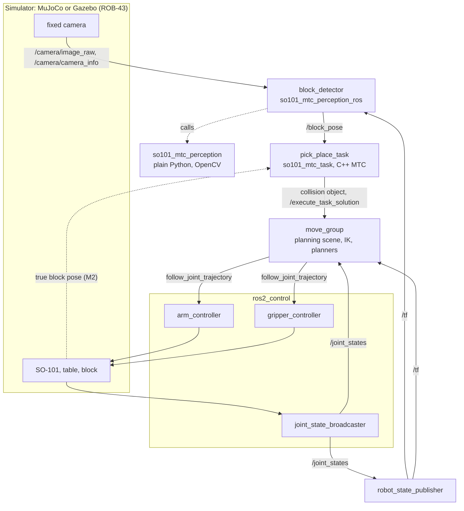
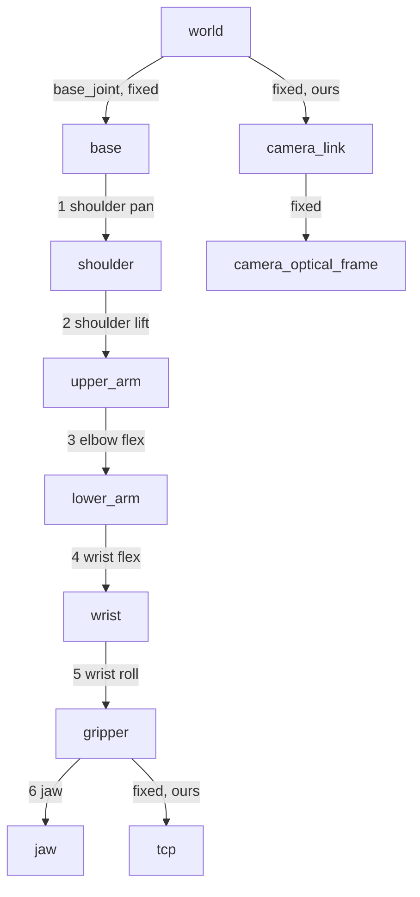

# Architecture

Planned for M1–M4; nothing here is built yet. The simulator, its camera topics, the robot model (and so the link
names) and the gripper controller follow the stack spike (ROB-43); the IK and the grasp poses follow ROB-44.

## Nodes and topics

- **Simulator** (MuJoCo through `mujoco_ros2_control` or Gazebo through `gz_ros2_control`): SO-101, a table, the
  block and a camera fixed in the scene (the robot models have none). It also knows the block's true pose: the input
  of the MTC task in M2, before the camera, and the success check of the episodes in M4.
- **block_detector** (`so101_mtc_perception_ros`, M3): a thin node. It turns the image, `camera_info` and the
  camera's TF into numpy and calls `so101_mtc_perception`: a colour mask and a contour give the block's pixel and
  yaw, `geometry.pixel_to_plane` the point on the table. It publishes `/block_pose`.
- **pick_place_task** (`so101_mtc_task`, C++, M2): adds the block to the planning scene as a collision object, plans
  the MTC task and sends the solution to `move_group` for execution.
- **move_group** (MoveIt 2 with our `so101_mtc_moveit_config`): the planning scene, the IK plugin, the planners, the
  MTC execution capability and trajectory execution through the controllers.
- **ros2_control**: `arm_controller` (joints "1"–"5") and `gripper_controller` (joint "6") execute trajectories;
  `joint_state_broadcaster` publishes `/joint_states`.
- **robot_state_publisher**: the robot description and `/joint_states` → TF of the links.
- **RViz** (not drawn): MotionPlanning and the MTC panel, to inspect the task's stages and solutions.

### Topics and actions

- `/camera/image_raw` (`sensor_msgs/Image`), `/camera/camera_info` (`sensor_msgs/CameraInfo`): sensor-data QoS (best
  effort, keep last): a lost frame is replaced by the next one. `camera_info` gives K for `pixel_to_plane`.
- `/block_pose` (`geometry_msgs/PoseStamped` in `world`): reliable and transient local, so a task started later
  still gets the last pose.
- `/joint_states` (`sensor_msgs/JointState`): from `joint_state_broadcaster`.
- `/tf`, `/tf_static` (`tf2_msgs/TFMessage`): the links from `robot_state_publisher`; the camera and the TCP are static.
- `/execute_task_solution` (action `moveit_task_constructor_msgs/action/ExecuteTaskSolution`): served by the MTC
  capability of `move_group`.
- `/arm_controller/follow_joint_trajectory`, `/gripper_controller/follow_joint_trajectory` (action
  `control_msgs/action/FollowJointTrajectory`): MoveIt → ros2_control.

### One pick and place

1. Perception (M3): the camera image → `block_detector` → `/block_pose` (the position on the table and the yaw). In M2
   the simulator's true pose takes its place.
2. Planning: `pick_place_task` puts the block into the planning scene and plans the MTC task: current state → open the
   gripper → move to the grasp → approach → grasp poses reachable with 5 joints (ROB-44) and IK → close → attach the
   block → lift → move to the place → lower → open → detach → retreat → home.
3. Execution: the solution goes to `move_group` (`/execute_task_solution`), which sends the trajectories to the
   controllers.
4. Feedback: the simulator moves the arm; `/joint_states` and TF keep MoveIt and the detector up to date. In M4 an
   episode runner checks the success in the simulator and starts the next episode.

## TF frames

- Link and joint names as in `lerobot_ws` (joints "1"–"6"). If ROB-43 picks the official SO-101 model, the names
  change and the structure stays.
- `world → base`, `world → camera_link → camera_optical_frame` and `gripper → tcp` are fixed; the arm's links follow
  `/joint_states` through `robot_state_publisher`.
- `tcp` is ours: the point between the jaws that MTC grasps with. `so101_lerobot` puts it 0.098 m along −Z of
  `gripper`; ROB-44 fixes it here.
- `camera_optical_frame` follows REP 103 (z forward, x right, y down). `pixel_to_plane` works in it and takes its pose
  in `world` from TF.
- The block is not a TF frame: it is a collision object in MoveIt's planning scene, with its pose in `world`.
