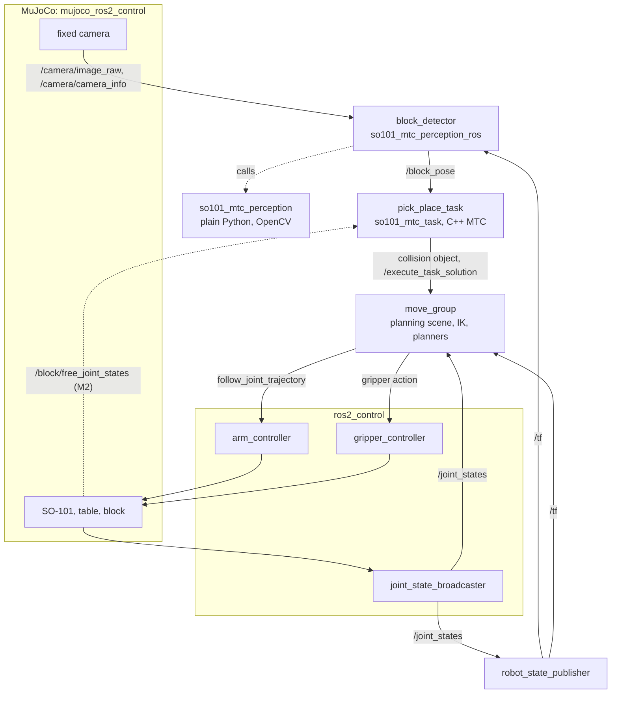
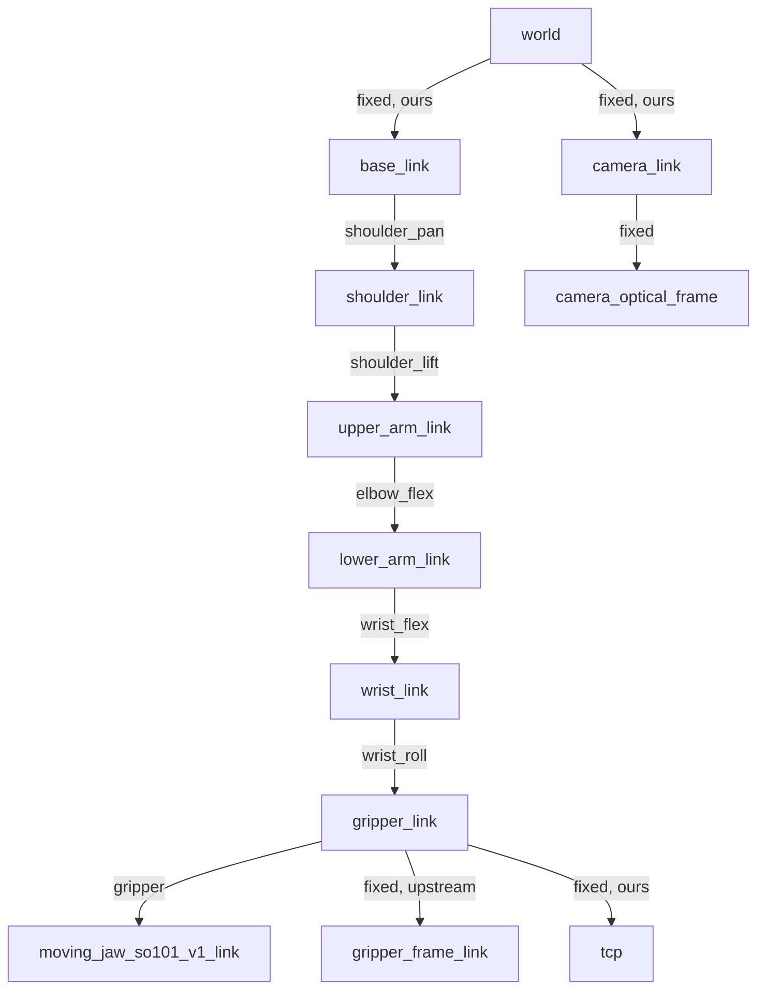

# Architecture

Planned for M1–M4; nothing here is built yet. The stack follows
[ADR 0002](decisions/0002-simulator_mtc_build_and_robot_model.md): MuJoCo through `mujoco_ros2_control`, MTC from
apt, the official SO-101 model (the stack spike ROB-43 ran this layout); the IK and the grasp poses follow
[ADR 0003](decisions/0003-ik_and_grasp_poses.md).

## Nodes and topics

- **Simulator** (MuJoCo through `mujoco_ros2_control`): its `ros2_control_node` runs the physics of our scene (the
  Menagerie SO-101 attached unmodified, a table, the block and a camera fixed in the scene; the robot models have
  none) behind the ros2_control hardware interface. Its plugins publish the camera (colour, depth, `camera_info`)
  and the block's true pose: the input of the MTC task in M2, before the camera, and the success check of the
  episodes in M4. Its services `reset_world` and `set_free_joint_state` (under `/mujoco_ros2_control_node/`) reset an
  episode.
- **block_detector** (`so101_mtc_perception_ros`, M3): a thin node. It turns the image, `camera_info` and the
  camera's TF into numpy and calls `so101_mtc_perception`: a colour mask and a contour give the block's pixel and
  yaw, `geometry.pixel_to_plane` the point on the table. It publishes `/block_pose`.
- **pick_place_task** (`so101_mtc_task`, C++, M2): adds the block to the planning scene as a collision object, plans
  the MTC task and sends the solution to `move_group` for execution.
- **move_group** (MoveIt 2 with our `so101_mtc_moveit_config`): the planning scene, the IK plugin, the planners, the
  MTC execution capability and trajectory execution through the controllers.
- **ros2_control**: `arm_controller` (`shoulder_pan`, `shoulder_lift`, `elbow_flex`, `wrist_flex`, `wrist_roll`)
  executes trajectories; `gripper_controller` (`gripper`) is a gripper action controller that stops on the block
  (`allow_stalling`, ADR 0002); `joint_state_broadcaster` publishes `/joint_states`.
- **robot_state_publisher**: the robot description and `/joint_states` → TF of the links.
- **RViz** (not drawn): MotionPlanning and the MTC panel, to inspect the task's stages and solutions.

### Topics and actions

- `/camera/image_raw` (`sensor_msgs/Image`, rgb8), `/camera/camera_info` (`sensor_msgs/CameraInfo`): sensor-data
  QoS (best effort, keep last): a lost frame is replaced by the next one. `camera_info` gives K for
  `pixel_to_plane`. `/camera/depth/image_raw` (32FC1) comes with them; the rate counts in simulation time.
- `/block/free_joint_states` (`mujoco_ros2_control_msgs/FreeJointStateArray`): the block's true pose in `world`.
- `/block_pose` (`geometry_msgs/PoseStamped` in `world`): reliable and transient local, so a task started later
  still gets the last pose.
- `/joint_states` (`sensor_msgs/JointState`): from `joint_state_broadcaster`.
- `/tf`, `/tf_static` (`tf2_msgs/TFMessage`): the links from `robot_state_publisher`; the camera and the TCP are static.
- `/execute_task_solution` (action `moveit_task_constructor_msgs/action/ExecuteTaskSolution`): served by the MTC
  capability of `move_group`.
- `/arm_controller/follow_joint_trajectory` (action `control_msgs/action/FollowJointTrajectory`) and the gripper
  controller's action (its type is chosen in M2): MoveIt → ros2_control.

### One pick and place

1. Perception (M3): the camera image → `block_detector` → `/block_pose` (the position on the table and the yaw). In M2
   the simulator's true pose takes its place.
2. Planning: `pick_place_task` puts the block into the planning scene and plans the MTC task: current state → open the
   gripper → move to the grasp → approach → grasp poses reachable with 5 joints (ADR 0003: our generator of exactly
   reachable poses, `GeneratePose` + `ComputeIK` with KDL; top-down near the base, tilted further out) → close →
   attach the block → lift → move to the place → lower → open → detach → retreat → home.
3. Execution: the solution goes to `move_group` (`/execute_task_solution`), which sends the trajectories to the
   controllers.
4. Feedback: the simulator moves the arm; `/joint_states` and TF keep MoveIt and the detector up to date. In M4 an
   episode runner checks the success in the simulator and starts the next episode.

## TF frames

- Link and joint names of the official SO-101 URDF `so101_new_calib` (ADR 0002); the Menagerie MJCF uses the same
  joint names, so ros2_control maps them one to one.
- `world → base_link`, `world → camera_link → camera_optical_frame` and `gripper_link → tcp` are fixed; the arm's
  links follow `/joint_states` through `robot_state_publisher`.
- `tcp` is ours: the point between the jaws that MTC grasps with. The upstream `gripper_frame_link` lies 7.9 mm off
  the `wrist_roll` axis and Menagerie's `gripperframe` site 19.9 mm from it. ADR 0003 puts `tcp` at the measured
  centre of a grasped 25 mm block, (0.0039, −0.0002, −0.0958) m in `gripper_link`: 3.9 mm off the roll axis, which
  the grasp pose generator accounts for.
- `camera_optical_frame` follows REP 103 (z forward, x right, y down). `pixel_to_plane` works in it and takes its pose
  in `world` from TF.
- The block is not a TF frame: it is a collision object in MoveIt's planning scene, with its pose in `world`.
