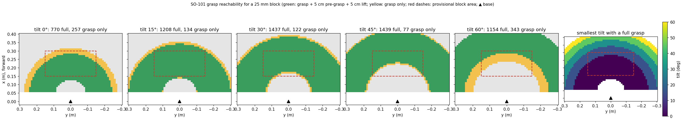

# 0003. IK and grasp poses for the 5-joint arm

- Status: Accepted
- Date: 2026-11-14

## Context

ADR 0001 requires grasp poses that the 5-joint SO-101 can reach. ADR 0002 fixed the robot model (the official URDF),
MoveIt and MTC from apt, and MuJoCo. The prior-art review (ROB-42) expected trouble: MoveIt's IK solvers work on full
6-D poses, while a 5-joint arm reaches only poses whose approach lies in its vertical arm plane, the plane of the
pitch joints, which turns about the shoulder_pan axis.

The spike ROB-44 measured the following. Its code is in `~/code/experiments/so101_mtc_ik_spike`, its results in
`~/data/so101_mtc/ik_spike`.

- **TCP:** a grasped 25 mm block sits at (3.9, −0.2, −95.8) mm in `gripper_link` (MuJoCo, 6 of 6 grasps, spread
  < 0.6 mm). That is between the jaws, but 3.9 mm off the `wrist_roll` axis, because only one jaw moves and it
  pushes the block against the fixed one. The jaw stops at 0.10 rad with a 0.1 rad target, at about half the
  actuator's force.
- **Reachability:** solved with our own numeric IK on the URDF, on a 1 cm grid. A grasp counts when the grasp,
  a pre-grasp 5 cm back along the approach and a lift 5 cm up all have collision-free solutions in MoveIt.
  - Top-down: 0.09–0.245 m from the shoulder_pan axis, for any yaw of the block.
  - Approach tilted away from the base: 15° reaches 0.10–0.30 m, 30° 0.14–0.35 m, 45° 0.19–0.39 m,
    60° 0.25–0.42 m.
  - Over the provisional block area (x 0.15–0.30 m, |y| ≤ 0.15 m): top-down 76 %, 15° 100 %, 30° 92 %.

  
- **MoveIt's IK** (`/compute_ik`, seeded from the home pose, 60 poses per family):
  - KDL on the full pose solves exactly reachable poses: 300 of 300 in about 1 ms.
  - Poses built from the block's azimuth about the shoulder_pan axis fail when tilted: 0 of 240, each after the
    50 ms timeout. The arm plane has to contain the `wrist_roll` axis, not the TCP, which lies 3.9 mm off it.
  - With the plane's azimuth corrected in closed form, KDL solves 240 of 240 tilted poses and 58 of 60 top-down
    poses in about 1 ms. The correction is φ' = φ − asin((s · t_x + e) / r), where:
    - r is the block's distance from the shoulder_pan axis and φ its azimuth about it;
    - s = ±1 is the side of the jaw axis;
    - t_x = 3.9 mm is the TCP's offset across the plane;
    - e = −0.18 mm is the plane's offset from the axis in the URDF.
  - KDL with `position_only_ik` solves every pose but leaves the gripper's orientation arbitrary (100° off, median),
    which is useless for grasping.
- **MTC's `GenerateGraspPose`** samples orientations about one axis of the object frame. Tilted samples miss the
  arm plane, so full-pose IK rejects them.

## Decision

1. **Grasp family.** Top-down where it reaches, up to about 0.24 m from the shoulder_pan axis: the wrist roll turns
   the jaws to the block's faces. Further out, the smallest tilt that reaches (15°, then 30°), leaning away from
   the base, with the jaws horizontal. Every grasp has a 5 cm pre-grasp along the approach and a 5 cm vertical lift.
2. **Grasp poses.** Our own generator builds exactly reachable poses with the closed-form azimuth correction and
   feeds them to MTC's `GeneratePose` + `ComputeIK`, one alternative per family and jaw side. `GenerateGraspPose`
   serves only as a top-down baseline.
3. **IK.** KDL, MoveIt's default from apt. Poses built this way need neither pick_ik nor TRAC-IK.
4. **TCP.** Our description adds a `tcp` frame at (0.0039, −0.0002, −0.0958) m in `gripper_link` for the 25 mm
   block. Its x follows the block's width: the fixed jaw's face is at x ≈ −8.6 mm.
5. **Gripper.** It closes with a force-limited command (ADR 0002); on the 25 mm block, contact comes at about
   0.10 rad.

## Consequences

- **Kinematic facts:** the generator needs the shoulder_pan axis (38.8 mm in front of `base_link`), the plane offset
  e, the TCP and the list of tilts. They come from the URDF and the measurement, and the generator's tests in M2
  check its poses against MoveIt's FK.
- **Straight-line stages:** a straight approach along the gripper's axis and a vertical lift keep the orientation
  and the arm plane, so MTC's Cartesian stages stay exactly reachable.
- **Open for M2:**
  - 2 of 60 top-down poses with the jaws across the arm plane found no KDL solution. A wrist-roll limit is the
    likely cause; to check. Update 2026-11-19 (ROB-48, ROB-51): confirmed. `wrist_roll` = β + 92.8° stops at
    −157°/+163°, and none of the 265 jaw sides in that gap over the task area has a solution. The generator uses the
    other jaw side. Source: `so101_mtc_task/test/test_grasp_poses.cpp` with MoveIt 2.12.4 from apt.
  - Family limits, update 2026-11-19 (ROB-51): the same test, run with the limits of this ADR's map (`max_radii`
    0.24, 0.30, 0.35 m; the block every 1 cm and 5°, the target every 2 cm and 10°), failed only at those limits.
    At 0.24 m top-down, 30 pre-grasps had no solution, and so did 78 pre-places; at 0.30 m tilted 15°, 65
    pre-places, for every held block. The place is higher than the grasp (clearance and the held block's tilt),
    which costs reach. With 0.23 m and 0.29 m, every pose solves; both stay within the decision's "about 0.24 m".
  - A tilted grasp keeps the jaws horizontal, so it grips a block whose faces do not face the arm plane by its
    edges. To test in MuJoCo; the fallback is to keep the block area in the top-down zone. Update 2026-11-19
    (ROB-52): the jaws stay horizontal, and the approach gap grows by how much further the block's corner reaches
    across them, half the edge × (cos ψ + sin ψ − 1) for a misalignment ψ. Closing then turns the block between the
    jaws and pushes it onto the fixed one. In MuJoCo, tilted grasps of blocks turned against the jaws ended on the
    target (README, "Pick and place with MTC"; check: `~/code/experiments/so101_mtc_task_check`), so the fallback is
    not needed; ROB-53's trials (README, "Trials") support it. Jaws
    rolled to face the block's sides were tried and dropped: at 30°, the lowered fixed jaw hits the table, and a
    rolled jaw sweeps into it as it closes (`test_grasp_poses`, MTC's collision check).
  - The TCP and the contact angle change with the block's size, which project 1's ROB-17 fixes.
- **Block area:** the map covers the provisional block area; the generator covers the whole reachable ring whatever
  area ROB-17 sets.
